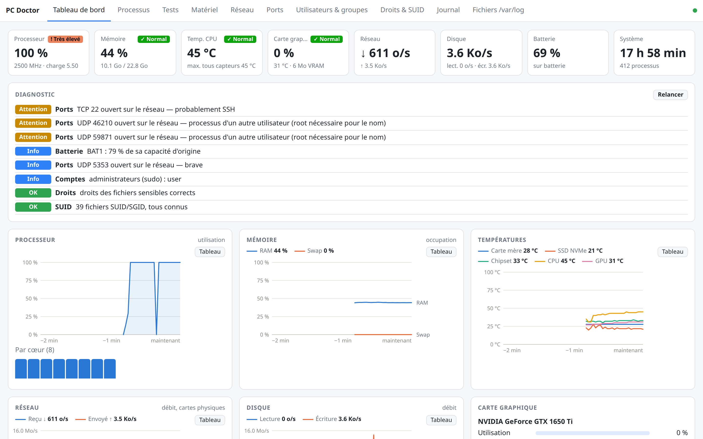
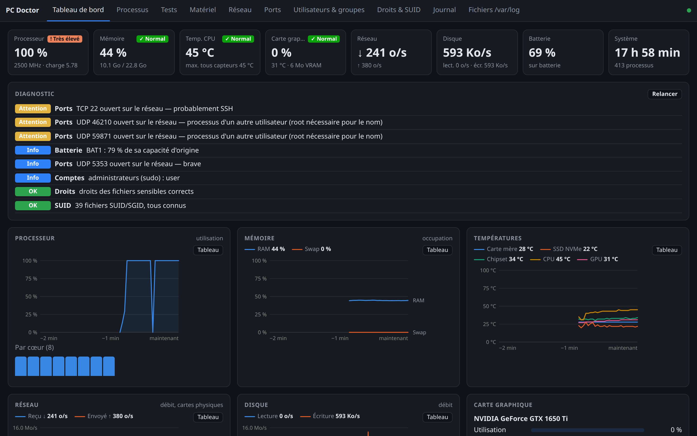
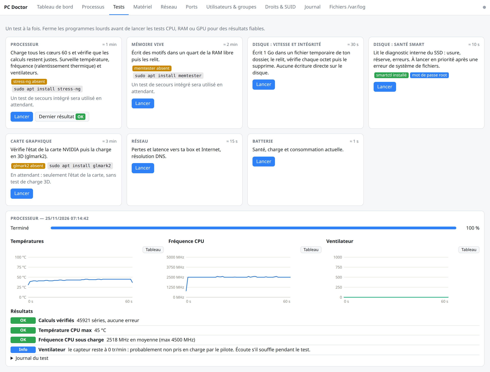
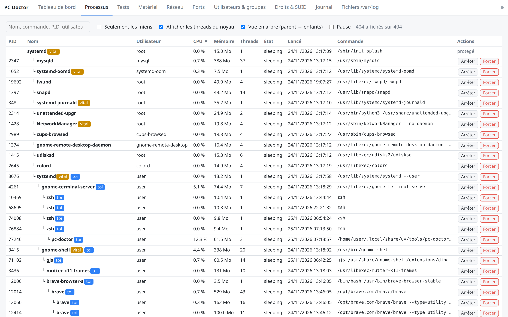
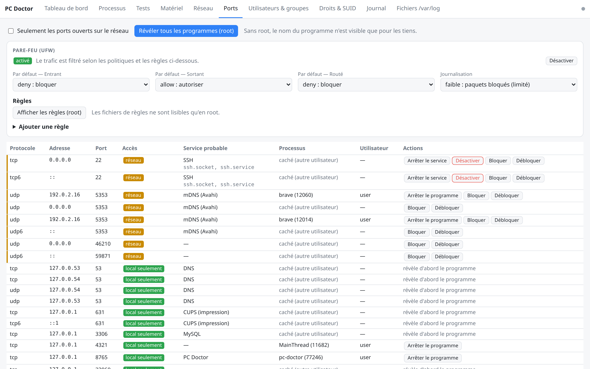
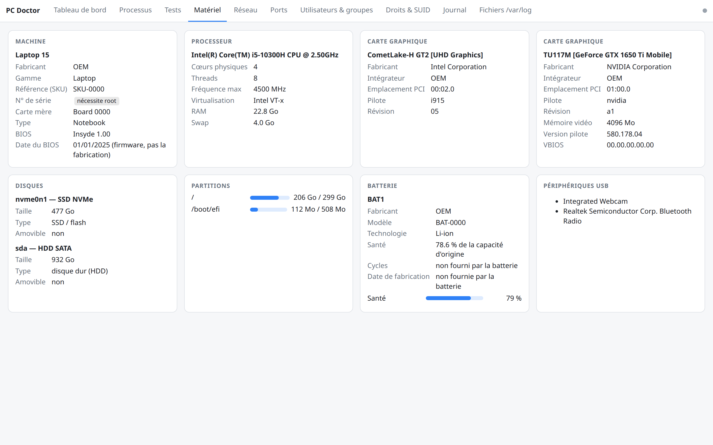
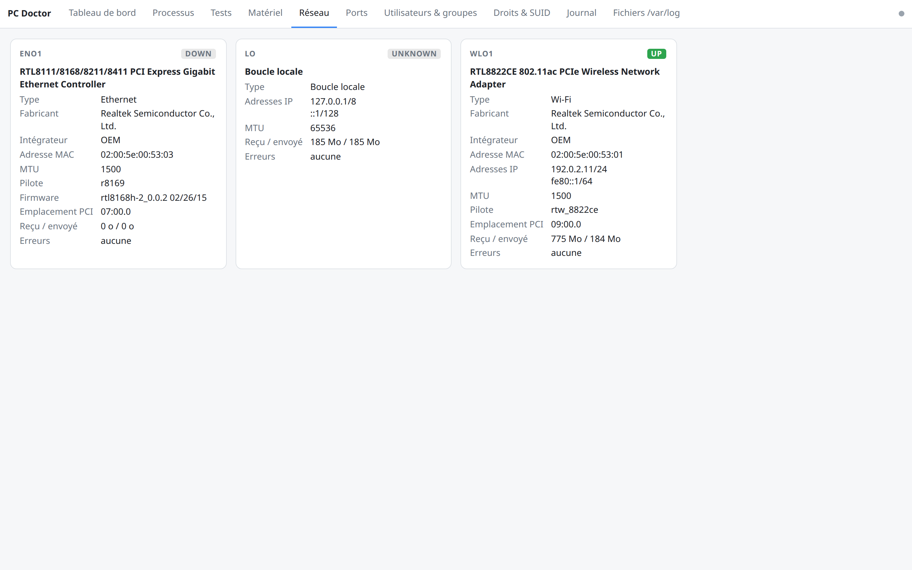
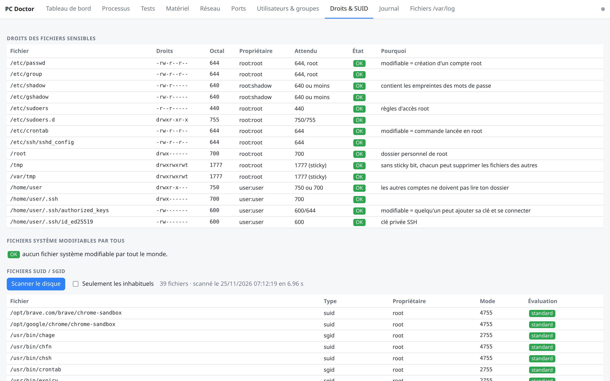
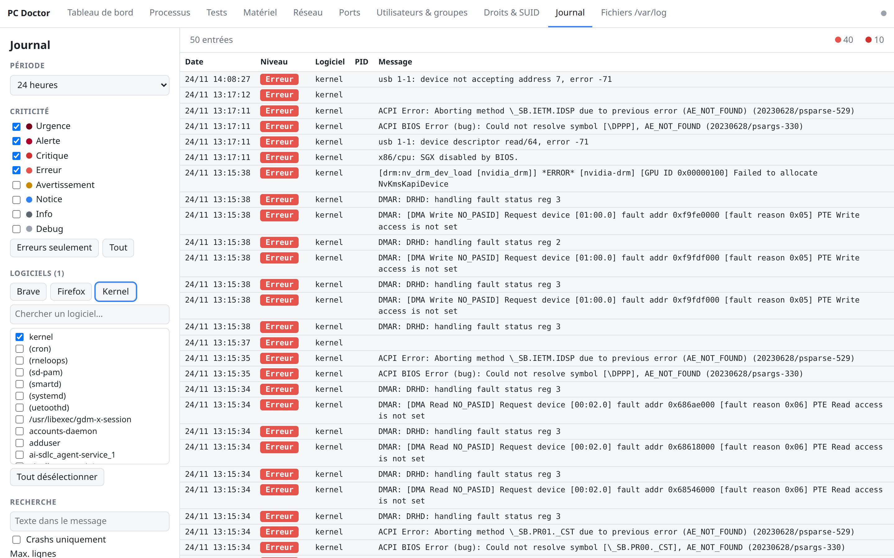
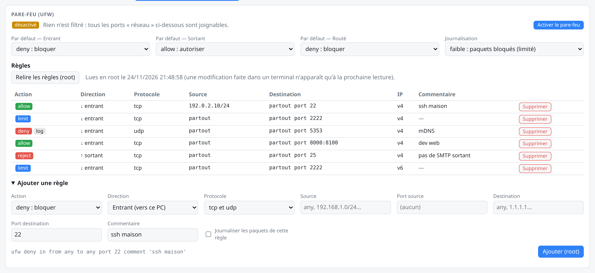

# PC Doctor

Local web dashboard to monitor and diagnose a Linux PC, **as a normal user (no root)**:

| Tab | Content |
|---|---|
| Tableau de bord | status tiles and interactive charts (CPU, RAM, temperatures, network, disk, GPU; 2-minute history, every 2 s) and a prioritized diagnosis |
| Processus | every process (search, sort, tree view) with **Arrêter** (SIGTERM) / **Forcer** (SIGKILL) |
| Tests | CPU, RAM, disk speed + integrity, SMART, GPU, network, battery, with live temperature/frequency/fan charts |
| Matériel | machine, BIOS, CPU, disks, partitions, battery health, GPUs (with NVIDIA details), USB devices |
| Réseau | interfaces with their physical card (vendor, driver, firmware, PCI slot), MAC, IPs, traffic |
| Ports | listening sockets, owning program (root "reveal"), stop/disable the systemd service, ufw firewall: on/off, default policies, logging, incoming/outgoing rules |
| Utilisateurs & groupes | accounts, admins, sensitive groups, login history |
| Droits & SUID | permission audit of sensitive files, world-writable files, SUID/SGID scan |
| Journal | systemd journal with filters (software, priority, time range, crashes) |
| Fichiers /var/log | readable text/gzip log files, filtered and followed live |


## Screenshots



| | |
|---|---|
|  Dark mode |  CPU test with live temperature, frequency and fan |
|  Every process as a tree, with stop / force actions |  Listening ports, systemd units, ufw |
|  Hardware inventory |  Network cards and their hardware |
|  Sensitive file permissions and SUID audit |  systemd journal with filters |
|  ufw: default policies, logging, rules and rule builder (example rules) | |

Personal data (user name, MAC and private IP addresses) is masked in these images by
`scripts/portfolio-screenshots.mjs`, which can regenerate them.

## Install and run

```bash
uv sync
uv tool install --editable .   # once: installs the `pc-doctor` command
pc-doctor                      # starts the server and opens the browser
pc-doctor --port 9000 --no-browser
```

## Optional tools (better tests)

```bash
sudo apt install stress-ng memtester glmark2
```

Without them, the CPU and RAM tests use built-in Python fallbacks and the GPU test only checks the
card's state. Linux can only test the RAM it lends to a program: for a full RAM test use
**memtest86+** (GRUB menu or USB key).

## Root actions

The server always runs as your user. Killing another user's process, revealing port owners,
stopping a service, reading SMART data and managing ufw each open the **system password dialog**
(polkit) for that single action; the password never goes through PC Doctor.

### Firewall (ufw)

- **On / off**, **default policies** (incoming, outgoing, routed: allow / deny / reject) and
  **logging level** (off → full) are read without root from `/etc/ufw/ufw.conf` and
  `/etc/default/ufw`; changing them asks for the password.
- **Rules** live in root-only files (`/etc/ufw/user.rules`, `user6.rules`): "Afficher les règles"
  reads them once as root. Every firewall change runs `ufw` and re-reads the rules in the same
  root call, so one password both changes the firewall and refreshes the list.
- **Add a rule**: action, direction (in / out), protocol, source / destination (IP or CIDR),
  ports (`22`, `8000:8100`, `80,443`), logging and comment. Every field is validated by Pydantic
  and again before running ufw (argument list, no shell).
- **Delete a rule**: the page only sends the rule's id; the `ufw delete …` command is rebuilt
  from the rules root read, never from text sent by the page.

## What needs root (shown as "nécessite root")

- serial numbers / UUID of the machine (DMI);
- the name of a process that owns a port when it belongs to another user (e.g. `sshd`);
- failed logins (`/var/log/btmp`), password hashes (`/etc/shadow`);
- full SMART disk data.

Reading the system logs requires membership of the `adm` or `systemd-journal` group.
Hardware **manufacturing dates are not exposed by Linux** for GPUs or network cards;
the BIOS date is the firmware date. Some batteries report their own.

## Security

- Bound to `127.0.0.1` only, with a Host header check (DNS rebinding), a strict CSP,
  and a CSRF guard on every action. Never bind to `0.0.0.0`: this page
  is a full map of the machine.
- Only the user running PC Doctor can use it: the owner UID of each client connection
  is checked in `/proc/net/tcp` (other local accounts get 403).
- Kills go through a pidfd with a start-time check (no PID-reuse race, even while the
  password dialog is open); root steps run fixed code that only reads kernel data.
- The systemd units to stop are computed by the server, never sent by the page.
- `pc-doctor` refuses to run as root.
- External tools are called with argument lists (no shell) and timeouts.
- Log file paths are resolved and confined to `/var/log` (path traversal).

Tests: `uv run pytest`
